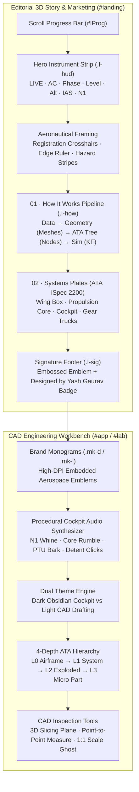

# AeroDissect Workbench // Global Aircraft Dissection & Digital Twin Encyclopedia


[](https://threejs.org/)
[](https://vitejs.dev/)
[](https://www.khronos.org/webgl/)
[](https://developer.mozilla.org/en-US/docs/Web/API/Web_Audio_API)
[](https://www.airlines.org/)

**AeroDissect** is an enterprise-grade 3D aerospace engineering workbench and interactive digital twin encyclopedia. Rebuilt from published engineering data, AeroDissect allows aerospace engineers, pilots, and aviation enthusiasts to dissect 74 aircraft airframes down to individual turbine blades, actuate flight controls in real time, monitor live glass cockpit avionics, and fly gate-to-gate with procedural acoustic telemetry.

---

## 🌟 Key Architecture & Capabilities



### 1. 4-Level ATA iSpec 2200 Dissection Hierarchy
- **Level 0 (Complete Airframe):** Kinematic motion suite with articulating double-slotted Fowler flaps, leading-edge slats on curved tracks, multi-wheel bogie articulation, and translating cowl reverser sleeves.
- **Level 1 (Ghost Cutaway):** Skin opacity dissolves outer composite/aluminum panels to reveal the internal wing box, 533 mm frame pitch, stringers, floor beams, cargo containers, and aft pressure dome.
- **Level 2 (Sub-Assembly Exploded View):** Axial and radial separation along genuine engineering vectors (thrust reverser cascades, fan rotor, LPC, HPC, combustor, HPT, LPT, gear trunnions, brake stator stacks).
- **Level 3 (Micro-Component Live Mechanism):** Isolation of precision mechanisms with oscillating kinetic linkages, swashplates, planetary gearboxes, and gas-temperature heat maps.

### 2. Dual-Mode Architecture & Pneumatic Transition
- **Landing Mode (`#landing`):** Dark Charcoal & Aviation Yellow editorial experience featuring a 560vh scroll-driven 3D airframe teardown story, live bento radar/PFD, interactive system plates with 3D mini-studios, and a 74-airframe blueprint fleet rail.
- **CAD Workbench (`#app` / `#lab`):** 48px top command bar, 280px left dock with expandable ATA hierarchy and fleet navigator, 344px right telemetry inspector, 52px flight timeline with TLA thrust lever detents, 3D section slicing plane, point-to-point measure tool, and 1:1 scale ghost / split-view comparator.
- **Pneumatic Shutter Transition (`#curtain`):** Transitions seamlessly between overview and CAD workbench without reloading or losing 3D state.

### 3. Dual-Theme Engine (Glass Cockpit Obsidian vs. Swiss CAD Drafting)
- **Default Dark Avionics Mode (`--bg: #07090e`):** Obsidian paneling, bezel borders (`#1c2433`), electric cyan vectors (`#00e5ff`), caution gold (`#f59e0b`), and warning red (`#ef4444`). The 3D scene background, fog, and grid matrices dynamically sync to `0x07090e`.
- **Light CAD Drafting Mode (`--bg: #f4f4f5`):** Clean technical drafting paper with crisp contrast lines and studio lighting.
- **Tactile Hotkey:** Toggle anytime via the top bar `#themeBtn` or press <kbd>T</kbd>.

### 4. Procedural Cockpit Web Audio Synthesizer (`CockpitAudio`)
- Zero external audio files; 100% synthesized procedural sound via the Web Audio API:
  - **N1 Spool Whine:** Harmonically tuned dual oscillators (`sine` + `triangle`) routed through a resonant bandpass filter, continuously mapped to N1 RPM (from 180 Hz at `IDLE` to 920 Hz at `TOGA`).
  - **Core Combustion Rumble:** Pink/brown noise generator with dynamic lowpass filtering (90 Hz – 410 Hz) tracking engine throttle position.
  - **A320 PTU ("Barking Dog") Hydraulic Transfer:** Quadruple modulated sawtooth chirps reproducing hydraulic pump transfer pulses.
  - **Mechanical Avionics Relays & Switch Clicks:** High-frequency impulse bursts on detents, flaps, and switches.
  - **Tactile Hotkey:** Toggle mute anytime via `#soundBtn` / `#lSoundBtn` or press <kbd>M</kbd>.

### 5. 01 · How It Works Interactive Pipeline (`.l-how`)
- **01 · Published Data:** Real-time data panel displaying the exact column values (`id`, `L`, `S`, `H`, `D`, `sweep`, `eng`, `nEng`) for the active airframe.
- **02 · Parametric Synthesis:** Procedural geometry synthesis displaying the live mesh count dynamically generated in memory.
- **03 · ATA Parts Tree:** Complete iSpec 2200 decomposition displaying the total active nodes down to individual turbine blades and flap tracks.
- **04 · Live Simulation:** Gate-to-gate flight profile running in real time, streaming live Phase, Altitude, IAS, and N1 telemetry with an animated amber runner pulse (`lrun`).

---

## ✈️ Verified Global Fleet Coverage (74 Airframes)

| Category | Airframe Count | Representative Models | Powerplants Synthesized |
| :--- | :---: | :--- | :--- |
| **Airbus Commercial** | 16 | A220-300, A300-600R, A310-300, A318-A321neo, A321XLR, A330neo, A340-600, A350-900/1000, A380-800, BelugaXL | PW1500G, CFM56-5B, LEAP-1A, Trent 7000, Trent XWB-84/97, Trent 900, GP7270 |
| **Boeing Commercial** | 18 | B707-320B, B717-200, B727-200, B737-800/MAX 8/MAX 10, B747-400/-8I, B757-200, B767-300ER, B777-200LR/-300ER, B777-9, B787-8/9/10 | JT3D, BR715, JT8D, CFM56-7B, LEAP-1B, PW4056, GEnx-2B/1B, GE90-115B, GE9X |
| **Regional & Turboprops** | 10 | Embraer E175/E190-E2/E195-E2, ERJ-145, CRJ-900, Dash 8 Q400, ATR 42/72-600, Saab 340, Do 328JET | PW1900G, CF34-8E/8C, AE 3007, PW150A, PW127M |
| **Global Next-Gen & Eastern** | 10 | COMAC C919, C929, ARJ21, Antonov An-124, An-225 Mriya, Il-96-400, Tu-154M, SSJ100, MC-21-310 | LEAP-1C, CJ-2000AX, D-18T, PS-90A1, D-30KU, SaM146, PD-14 |
| **Supersonic & Historic** | 6 | Concorde, Tu-144, DC-10-30, MD-11, L-1011 TriStar, Douglas DC-3 | Olympus 593 Mk 610, NK-144A, CF6-50/80D, RB211-22B, R-1830 Twin Wasp |
| **Business & General Aviation** | 9 | Gulfstream G650ER/G700, Global 7500, Falcon 8X, Pilatus PC-12/PC-24, King Air 350i, Citation Longitude, C172 | BR725, Pearl 700, Passport, PW307D, PT6E, FJ44-4A, HTF7700L, IO-360 |
| **Military & Stealth** | 5 | C-130J, C-17 Globemaster, C-5M Super Galaxy, F-22 Raptor, F-35A Lightning II | AE 2100D3, F117-PW-100, F138, F119-PW-100, F135-PW-100 |

---

## ⌨️ Keyboard Shortcuts

| Key | Function |
| :--- | :--- |
| <kbd>Click</kbd> | Isolate system $\to$ explode sub-assembly $\to$ inspect micro-component |
| <kbd>Esc</kbd> | Ascend one dissection level up / dismiss popovers |
| <kbd>F</kbd> | Frame-to-fit camera onto active selection |
| <kbd>1</kbd> – <kbd>6</kbd> | Preset camera views: Isometric, Front, Rear, Top, Port, Starboard |
| <kbd>O</kbd> | Toggle true Orthographic parallel projection vs. Perspective |
| <kbd>M</kbd> | Toggle Point-to-Point 3D measurement tool ($\Delta X, \Delta Y, \Delta Z$) |
| <kbd>E</kbd> | Toggle Shaded with Edges CAD display style |
| <kbd>T</kbd> | Toggle Dark Avionics Glass Cockpit vs. Light CAD Drafting mode |
| <kbd>Space</kbd> | Toggle Gate-to-Gate flight simulation playback |
| <kbd>[</kbd> / <kbd>]</kbd> | Collapse / expand left dock and right inspector |

---

## 🛠️ Development & Deployment

### Local Setup

```bash
# Clone the repository
git clone https://github.com/yashgaurav1/aerodissect.git
cd aerodissect

# Install dependencies (Three.js r186, Vite 8.3)
npm install

# Start local development server
npm run dev

# Build production bundle
npm run build

# Preview production build
npm run preview
```

### Static Hosting Support
The application is 100% client-side WebGL / Web Audio with zero external backend dependencies. Ready for instant deployment on **Vercel**, **Netlify**, or **GitHub Pages**.

---

## 👨‍💻 Author & Credits

- **Principal Architect & Lead Designer:** [Yash Gaurav](https://www.linkedin.com/in/yash-gaurav/)
- **License:** MIT License © 2026 AeroDissect
